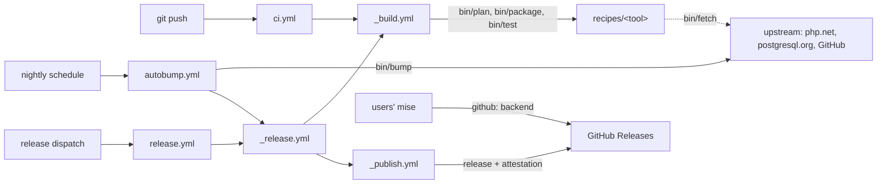

# Feature map

Start every task here: find the feature, open its paths, then read the code. The code is the truth; this map only says where to look.

A feature is anything a user starts from: an import, a config key, a command or a URL. Code with no entry point of its own belongs to the feature it serves.

- How recipes, releases and updates work: [CONTRIBUTING.md](../CONTRIBUTING.md). Commands: `AGENTS.md`.
- Change this file when a feature is added, removed, renamed or moved, or its purpose or entry point changes: keeping it current is the editor's job. `check-feature-map` checks that each entry has one Purpose, Entry and Paths line, the listed paths exist, relative links resolve, and every module under the coverage roots is claimed by a feature.

## Who calls whom

## Tools

### PHP

Purpose: static PHP CLI and FPM with the extensions WordPress and Laravel use
Entry: `mise.toml`: `"github:aysnc-labs/prebuilt-binaries" = ["php-<version>"]`
Paths: recipes/php/

### PostgreSQL

Purpose: PostgreSQL with contrib, PostGIS, TimescaleDB, pgvector and more
Entry: `mise.toml`: `"github:aysnc-labs/prebuilt-binaries" = ["postgres-<version>"]`
Paths: recipes/postgres/

### neon-proxy

Purpose: Neon's proxy with the Postgres auth backend, for local development
Entry: `mise.toml`: `"github:aysnc-labs/prebuilt-binaries" = ["neon-proxy-<version>"]`
Paths: recipes/neon-proxy/

## Building

### Local build and test

Purpose: build a recipe for this machine's target and run its test, as CI does
Entry: `bin/ci <tool> [--linux]`
Paths: bin/ci, bin/package, bin/test, bin/deps, bin/fetch, bin/recipe, lib/common.sh, lib/bundle.py, recipes/targets.yaml

### Validate

Purpose: the one gate: recipe schema, shellcheck, actionlint, pinned actions, this map
Entry: `bin/validate`
Paths: bin/validate, scripts/, lefthook.yml, .lefthook/

## Pipeline

### CI

Purpose: lint, then build and test the recipes a push changed
Entry: every push
Paths: .github/workflows/ci.yml, .github/workflows/_build.yml, bin/plan

### Release

Purpose: release recipes at their current version, attested, and check mise installs them
Entry: `release` workflow_dispatch with a tool name
Paths: .github/workflows/release.yml, .github/workflows/_release.yml, .github/workflows/_publish.yml

### Autobump

Purpose: move pins to the latest upstream, then build, test, release and land on main
Entry: nightly schedule, or `bin/bump <tool>` and `bin/lock <tool>` by hand
Paths: .github/workflows/autobump.yml, bin/bump, bin/lock
